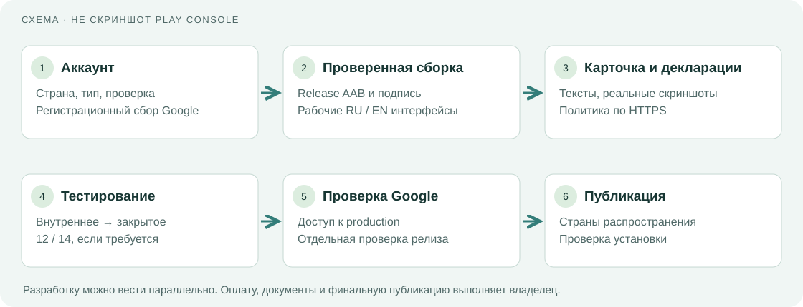
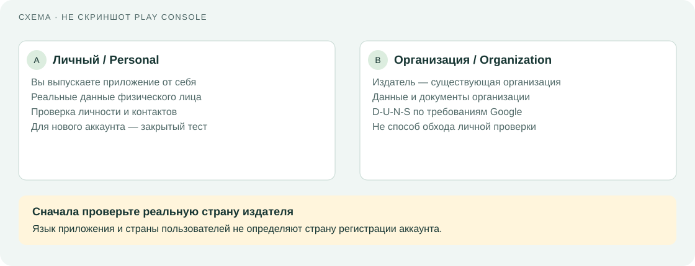
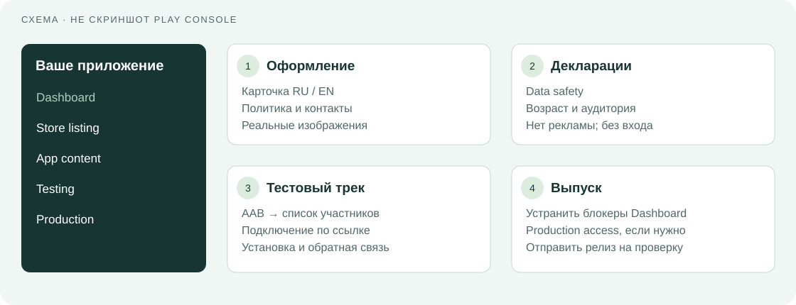
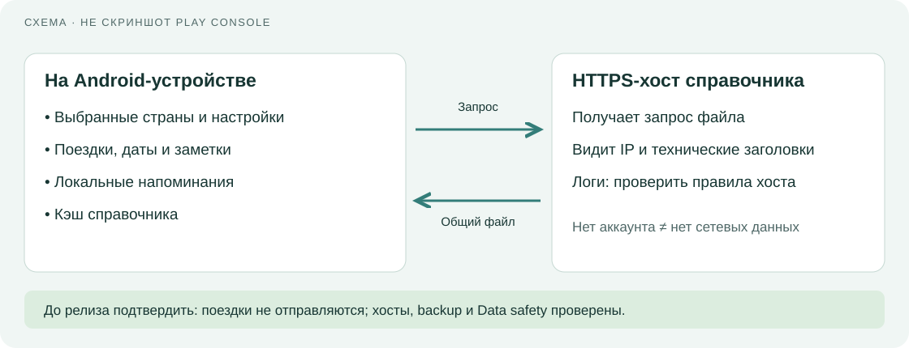
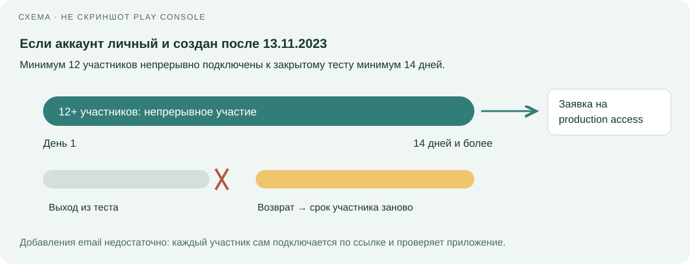

# Как выпустить «Атлас маршрутов» в Google Play

Рабочее название: **Атлас маршрутов / Wayfarer Atlas**. Проверка доступности бренда и имени в магазине ещё не проведена. Идентификатор: `org.wayfarer.atlas` — предварительный, согласовать до первой загрузки. Инструкция для первого выпуска, обновлена **26 октября 2026 года**. Наличие этой инструкции не означает, что приложение уже опубликовано или аккаунт создан.

Откройте [иллюстрированную версию](google-play-guide.ru.html). Она работает без интернета; ссылки на Google требуют подключения. Этапы работы в Play Console показаны **схемами**, а не скриншотами вашего аккаунта. Кадры приложения для карточки магазина проверяются по версии и метаданным в шаге 7; файлы хранятся в `store-assets/screenshots/`. Названия разделов Google могут меняться; ориентируйтесь на список незавершённых задач в Dashboard.

## Пакет версии 0.1.1

Финальная сборка **0.1.1 (2)** прошла Android build: JVM, lint, debug/release APK и AAB. Пройдены **106 поведенческих сценариев**: 69 прежних Java, 20 новых Java и 17 Python. Gradle: 10 JVM suites / 27 JUnit tests без ошибок; wrapper-повторы отдельно к сумме не прибавляются. Android UI: **14 PASS**, один необязательный инструмент съёмки SKIP; ошибок нет. Среди новых сценариев — обязательность/сохранение/повторный просмотр предупреждения и фактическое официальное условие RU→HK.

Lint debug/release: по 0 ошибок и 19 предупреждений. Подписи финальных APK/AAB, ELF/RELRO/ZIP alignment и bundletool validate прошли; хеши записаны в [отчёте артефактов](artifact-verification.json), проверка [AAB](bundle-validation.md) приложена отдельно. Реальное обновление подписанной версии 0.1.0 → 0.1.1 сохранило тестовый журнал; ознакомление с предупреждением сохранилось после перезапуска. Синтетическая поездка затем удалена через интерфейс, журнал остался пустым после перезапуска. Текущие runtime-результаты и съёмка отражены в [проверке 0.1.1](../verification-0.1.1.md). Результаты 0.1.0 остаются историей и не подменяют новые проверки.

На подписанной 0.1.1 успешно загружены оба общих файла: community — 26.10.2026 07:52:31 UTC, HK — 07:52:34 UTC. В настройках показаны четыре источника и дата состояния HK 2025-12-31; карточка RU→HK показывает 14 дней и официальную ссылку. Кэши, их метки времени и это условие сохранены после холодного запуска. Получение файла не означает повторной проверки всех его правил. Восемь свежих кадров RU/EN показаны в шаге 7.

| Файл пакета | Назначение |
|---|---|
| [wayfarer-atlas-0.1.1.aab](https://github.com/ArtiomNosov/wayfarer-atlas/releases/download/v0.1.1/wayfarer-atlas-0.1.1.aab) | Release Android App Bundle для Play Console; проверяется подпись и SHA-256 |
| [wayfarer-atlas-0.1.1-release.apk](https://github.com/ArtiomNosov/wayfarer-atlas/releases/download/v0.1.1/wayfarer-atlas-0.1.1-release.apk) | Подписанная release-версия для проверки установки |
| [wayfarer-atlas-0.1.1-debug.apk](https://github.com/ArtiomNosov/wayfarer-atlas/releases/download/v0.1.1/wayfarer-atlas-0.1.1-debug.apk) | Debug-сборка для разработки; в магазин не загружать |
| [wayfarer-atlas-0.1.1-source.zip](https://github.com/ArtiomNosov/wayfarer-atlas/releases/download/v0.1.1/wayfarer-atlas-0.1.1-source.zip) | Исходники и материалы без ключей подписи |
| [SHA256SUMS.txt](https://github.com/ArtiomNosov/wayfarer-atlas/releases/download/v0.1.1/SHA256SUMS.txt), [manifest.json](https://github.com/ArtiomNosov/wayfarer-atlas/releases/download/v0.1.1/manifest.json) | Контрольные суммы и размеры файлов пакета |

APK устанавливают на Android-устройство; AAB напрямую не устанавливают. Пакет не заменяет регистрацию Play Console, заполнение политики и требуемое тестирование. Приложение не опубликовано в Google Play.

## Что потребуется от вас

- Реальная страна проживания/регистрации издателя и выбор: физическое лицо или существующая организация. Русский язык интерфейса не определяет страну издателя.
- Google-аккаунт с двухэтапной проверкой, доступ к телефону и почте; владельцу аккаунта Play Console должно быть не менее 18 лет.
- Возможность пройти проверку личности и оплатить регистрационный сбор Google. Документы и платёжные сведения вводите только на официальных страницах Google; в чат их отправлять не нужно.
- Настоящий контакт поддержки, имя издателя и постоянный HTTPS-адрес политики конфиденциальности.
- Android-телефон для проверки приложения. Для нового личного аккаунта может понадобиться проверка устройства через приложение Play Console.
- Для нового личного аккаунта — минимум 12 реальных участников закрытого теста; ниже описан срок участия.

Это бесплатное приложение для пользователя. Google указывает разовый регистрационный сбор **25 долларов США** за аккаунт разработчика; его оплачивает издатель, бесплатные API его не отменяют. **Сумму в форме, валюту, доступность и способ оплаты проверьте до оплаты:** допустимые карты зависят от страны, предоплаченные карты не принимаются. [Официальная регистрационная инструкция](https://support.google.com/googleplay/android-developer/answer/6112435?hl=ru). Разработчик не создаёт аккаунт и не оплачивает сбор за вас.



## 1. Проверьте, можно ли зарегистрироваться из вашей страны

Откройте [список поддерживаемых стран для разработчиков](https://support.google.com/googleplay/android-developer/answer/9306917?hl=ru). Проверьте столбец регистрации разработчика для своей реальной страны. Регистрация продавца — отдельный вопрос; покупок и подписок в этом приложении нет.

Если ваша страна отсутствует либо регистрация/оплата недоступна, остановитесь на этом шаге и уточните у поддержки Google доступный официальный вариант. Не выбирайте фиктивную страну, адрес, организацию или чужие документы. Для России отдельно проверьте [актуальную информацию Google об ограничениях](https://support.google.com/googleplay/android-developer/answer/11950272?hl=ru); язык приложения не даёт оснований считать, что вы регистрируетесь из России.

**Результат:** вы знаете, поддерживается ли регистрация именно для вашего издателя. Этот пункт требует вашего ответа; разработка приложения может продолжаться параллельно.

## 2. Выберите тип аккаунта и зарегистрируйтесь

Откройте [официальную регистрацию Play Console](https://play.google.com/console/signup) и [справку о создании аккаунта](https://support.google.com/googleplay/android-developer/answer/6112435?hl=ru).

Выберите **Personal / Личный**, если выпускаете приложение от себя. Если издатель — действующая организация, выберите **Organization / Организация**. Google требует D‑U‑N‑S для проверки большинства организаций; для предусмотренных Google исключений следуйте форме. Не создавайте организацию только ради обхода тестирования. [Выбор типа аккаунта](https://support.google.com/googleplay/android-developer/answer/13634885?hl=ru).

Введите реальные сведения, прочитайте условия и проверьте, какие из них будут видны пользователям. Оплатите сбор после проверки суммы на экране. Сохраните квитанцию у себя. Завершите проверку личности и контактных данных по заданиям Dashboard; Google может запросить документы. Подробности: [проверка аккаунта](https://support.google.com/googleplay/android-developer/answer/14177239?hl=ru).

**Результат:** Dashboard показывает завершённую регистрацию. Мы не создавали аккаунт, не платили и не проходили проверку за вас.



## 3. Выполните проверку Android-устройства, если Google её запросит

В Dashboard найдите задание проверки устройства. Откройте его и следуйте QR-коду/ссылке на официальное приложение Google Play Console. Войдите тем же аккаунтом владельца и завершите проверку на физическом Android-телефоне без root-доступа, с Android 10 или новее. Эмулятор для этого этапа не заменяет реальный телефон.

Не путайте эту проверку с тестированием самого приложения. Эти требования подтверждены [инструкцией Google](https://support.google.com/googleplay/android-developer/answer/14316361?hl=ru) 25.10.2026; перед покупкой телефона сверьтесь с текущей страницей. Совместимость вашего конкретного телефона ещё нужно проверить.

**Результат:** задание проверки устройства завершено либо не требуется вашему аккаунту.

## 4. Зафиксируйте имя пакета и подготовьте подписанный AAB

В проекте используется рабочий пакет `org.wayfarer.atlas`. До первой загрузки проверьте, устраивает ли вас этот идентификатор: после загрузки имя пакета нельзя сменить у того же приложения. Если нужно другое имя, разработчик заменит его во всём проекте до загрузки. Имя пакета — постоянный технический идентификатор приложения. Отображаемое название магазина можно менять отдельно. [Создание и настройка приложения](https://support.google.com/googleplay/android-developer/answer/9859152?hl=ru).

Конфигурация выпуска: `versionName 0.1.1`, `versionCode 2`, Android 8.0 / API 26 и выше; target/compile API 36. С 31 августа 2026 года новые приложения и обновления для обычных Android-устройств должны иметь target Android 16 / API 36 или выше. [Требование Google](https://support.google.com/googleplay/android-developer/answer/11926878?hl=ru).

Для Google Play нужен **release AAB**, подписанный ключом загрузки. APK пригоден для установки и проверки, но не заменяет релизный Android App Bundle нового приложения в магазине. Разработчик должен передать AAB, номер версии и результаты проверки. Не загружайте debug APK или артефакт с тестовыми данными.

Включите **Play App Signing**. Google хранит ключ подписи приложения; отдельный ключ загрузки используется для отправки новых версий. Локальный ключ загрузки уже создан в закрытом, исключённом из Git каталоге `release-private/`. Не пересоздавайте его. Владелец сохраняет защищённую резервную копию **всего каталога**, включая файл настроек подписи; содержимое каталога не отправляется в чат, Git или публичное облачное хранилище. Для подписанной сборки разработчик выполняет из папки приложения:

```sh
python3 scripts/with-signing.py bash scripts/gradle.sh bundleRelease
```

Скрипт передаёт настройки подписи дочернему процессу и не печатает секреты. Наличие ключа не доказывает успешную сборку: перед загрузкой нужен новый AAB, проверка подписи и SHA-256. Для новой версии APK/AAB заново собираются с тем же upload key. Итоговые подпись AAB, хеши и установка именно передаваемой версии должны совпадать с [журналом проверки](../verification-0.1.1.md). Если владелец решит использовать другой ключ, это нужно сделать до первой загрузки и затем заново собрать AAB. Следующие обновления сохраняют имя пакета и увеличивают `versionCode`. [Подпись приложения](https://developer.android.com/studio/publish/app-signing), [Android App Bundle](https://developer.android.com/guide/app-bundle).

**Результат:** есть проверенный подписанный AAB. Отсутствие ключа/подписанного артефакта — блокер загрузки, а не повод выдавать debug-сборку за релиз.

## 5. Создайте приложение в Play Console

Нажмите **Create app / Создать приложение**. Введите рабочее название, выберите основной язык, тип **App / Приложение** и **Free / Бесплатно**. Примите требуемые декларации после прочтения. Затем добавьте русскую и английскую локализации карточки магазина.

Бесплатная модель соответствует продукту: нет аккаунтов, рекламы, встроенных покупок, подписок или платной разблокировки. Не добавляйте эти функции в декларации. Список экранов, которые нужно заполнить, появится в Dashboard. [Официальная инструкция](https://support.google.com/googleplay/android-developer/answer/9859152?hl=ru).

**Результат:** в Console есть черновик приложения; пользователи пока его не видят.



## 6. Опубликуйте политику конфиденциальности по HTTPS

В проекте есть [двуязычный черновик](../privacy-policy.html). Перед публикацией заполните имя/наименование издателя и контакт поддержки. В черновике указаны два хоста обновлений: `raw.githubusercontent.com` (GitHub) и `www.immd.gov.hk` (Immigration Department Hong Kong). Их официальные политики приведены в тексте; сверьте описание с фактической release-сборкой. Поле «дата вступления» заполните датой размещения окончательной политики.

Разместите файл как обычную общедоступную HTML-страницу на постоянном HTTPS-адресе: например, на своём сайте или доступном вам статическом хостинге. Откройте ссылку в приватном окне без входа. Страница должна читаться без разрешения на доступ и без скачивания PDF. Добавьте один и тот же URL в Play Console и в приложение. [Требования к политике и пользовательским данным](https://support.google.com/googleplay/android-developer/answer/10144311?hl=ru).

**Результат:** доступный публичный URL. Файл на ноутбуке и локальный `file://` адрес не подходят. Пока поля издателя/контакта не заполнены и страница не размещена, публикация заблокирована.

## 7. Заполните карточку магазина на двух языках

Возьмите тексты из [store-listing.md](../store-listing.md). Добавьте email поддержки. Выберите подходящую категорию, например **Travel & Local / Путешествия**, если она соответствует фактической версии.

В версии 0.1.1 объединены четыре источника: **38 822 уникальные пары**, 213 гражданств и 199 направлений источников. Community-основа из 38 612 пар дополнена отдельными официальными сведениями; размеры наборов не складываются напрямую из-за пересекающихся пар. HK CSV содержит 207 сопоставленных гражданств (203 известных условия); 60 новозеландских визовых исключений с NZeTA и одна проверенная поездка Россия — Макао поставляются со сборкой. Неоднозначные условия остаются UNKNOWN. Наличие отдельных официальных сведений не делает весь набор официальной актуальной базой.

Кнопка обновляет **community JSON и HK CSV**. NZ/MO обновляются с версиями приложения. HK CSV помечен **As at 31 December 2025**, его справочная HTML-страница пересмотрена 22.09.2026; проверка источника 26.10.2026 не подменяет эти даты. Для community-основы действуют версия 2026-08-11, дата среза 2026-08-10 и только 38 индивидуальных дат проверки. [Источники и лицензии](../data-sources.md).

При первом запуске приложение требует ознакомиться с предупреждением: данные могут быть неполными, неточными или устаревшими; перед покупкой билетов, подачей заявлений и каждой поездкой нужно проверять действующие требования в официальной иммиграционной службе или консульстве страны назначения. Отметка ознакомления сохраняется локально; предупреждение можно открыть снова в настройках. Этот экран не является подтверждением правильности выбранного условия или гарантией въезда.

Иконка 512×512, feature graphic 1024×500 RU/EN и восемь настоящих кадров 0.1.1 подготовлены. **Схемы инструкции нельзя использовать как скриншоты приложения в Google Play.** Не обещайте въезд без проверки. [Требования Google к графике](https://support.google.com/googleplay/android-developer/answer/9866151?hl=ru).

| Материал | Обязательный формат |
|---|---|
| Иконка магазина | 512×512 px, 32-bit PNG с alpha, до 1024 KB |
| Feature graphic | 1024×500 px, JPEG или 24-bit PNG без alpha |
| Скриншоты | Минимум 2; JPEG/24-bit PNG без alpha; стороны 320–3840 px, длинная не больше 2× короткой |
| Рекомендуемый набор | 4–6 реальных кадров на язык, например 1080×1920; карта, сравнение, рейтинг, поездки/напоминание, справочник |

**Результат:** русская и английская карточки описывают реальные экраны и имеют готовые иллюстрации. Видео для первого выпуска можно не добавлять.

### Реальные экраны приложения

Снята настоящая MainActivity версии **0.1.1 (2)** на Android ATD arm64 / API 36, 26.10.2026 в 07:54:25 UTC. Каждый PNG — 1080×1920, 24-bit RGB без alpha; после экспорта все RGB-пиксели совпали с оригиналом. Использованы справочные данные приложения, журнал пустой. Версия, устройство и метод указаны в [метаданных](store-assets/screenshots/capture-metadata.json), размеры и контрольные суммы — в [manifest SHA-256](store-assets/screenshots/manifest.json). Нажмите на кадр, чтобы открыть полный размер. Схемы Console остаются отдельными иллюстрациями.

### Русский интерфейс


### English interface


## 8. Заполните App content и Data safety по фактической сборке

В **Policy and programs → App content / Содержание приложения** заполните требуемые анкеты. Названия пунктов и их наличие могут отличаться для аккаунта. [Подготовка к проверке](https://support.google.com/googleplay/android-developer/answer/9859455?hl=ru).

| Пункт Console | Ответ/действие для этой версии |
|---|---|
| App access / Доступ | Все функции доступны без входа. Логин/тестовый аккаунт не нужны. |
| Ads / Реклама | Нет рекламы. Проверить, что в release нет рекламного SDK. |
| Content rating / Возрастной рейтинг | Честно пройти IARC-анкету; итоговый рейтинг назначает система, заранее его не выдумывать. |
| Target audience / Аудитория | Выбрать фактическую аудиторию; не отмечать детскую аудиторию ради расширения охвата. |
| Account deletion / Удаление аккаунта | Аккаунты не создаются; требование удаления аккаунта не применяется. Удаление локальных поездок остаётся функцией приложения. |
| Data safety | Сверить release, SDK и реальные сетевые запросы, затем заполнить анкету. |
| Дополнительные декларации | Отвечать по функциям; приложение не является государственным или официальным миграционным сервисом. |

Проверка Data safety — обязательный отдельный этап. Ни отсутствие регистрации, ни локальная база сами по себе не означают «приложение ничего не собирает». Выбор страны/гражданства, поездки и напоминания должны оставаться на устройстве. При нажатии «Обновить справочник» приложение скачивает общий community JSON около 2,93 MB с `raw.githubusercontent.com` и официальный HK CSV около 19,5 KB с `www.immd.gov.hk`. Запрос не включает гражданство, поездки, заметки, аккаунт, API-ключ или постоянный идентификатор устройства; сервер/CDN всё равно видит техническое соединение и IP-адрес. Проверьте, сохраняет ли хост эти данные, для чего, на какой срок, и передаются ли ещё заголовки/идентификаторы. От этого, правил сервиса и определений Google зависит декларация. [Определения и анкета Data safety](https://support.google.com/googleplay/android-developer/answer/10787469?hl=ru).

Используйте [подготовленные ответы Data safety](data-safety-checklist.ru.md): в них заполнены рекомендации по локальным данным, HTTPS, аккаунтам, рекламе и отсутствующим категориям. Отдельно оставлено узкое решение о классификации технических соединений внешних операторов; фиксированный срок логов и обработка только в памяти оператором не подтверждены. Для новой версии отдельно проверяются оба обновляемых источника; packet capture не заявляется.

**Результат:** декларации соответствуют коду, сетевому поведению и политике. Шаблон не подменяет проверку фактического AAB.



## 9. Загрузите сборку во внутренний тест

Откройте **Test and release → Testing → Internal testing / Внутреннее тестирование**. Создайте релиз, загрузите подписанный AAB и дождитесь проверки файла. Прочитайте предупреждения, добавьте краткие release notes на русском и английском. Добавьте свой Google-аккаунт в тестировщики, сохраните список и откройте ссылку подключения к тесту на телефоне.

Если на телефоне уже установлена тестовая APK-сборка и Android сообщает о конфликте подписей, сначала сохраните нужные сведения о поездках вручную: удаление тестового приложения удалит весь локальный журнал. Затем удалите конфликтующую тестовую сборку и установите вариант Google Play. Между разными подписями Android не обновляет одно приложение поверх другого.

Установите приложение через Google Play. Проверьте обязательное предупреждение первого запуска, сохранение ознакомления после перезапуска и повторный просмотр в настройках. Затем проверьте работу без входа, русский и английский языки, карту, сравнение, рейтинг, происхождение правил, создание/редактирование/удаление поездки, отказ/разрешение уведомлений и обновление данных. Повторите ключевые действия без интернета. Проверьте свежую установку и обновление поверх предыдущей версии. Напоминание планируется на 09:00 дня начала поездки по часовому поясу устройства при сохранении; Android/WorkManager может отложить его. Проверьте, что после изменения и удаления поездки не остаются старые уведомления, а при отказе в разрешении справочные функции работают. Отдельно проверьте Google pre-launch report и устраните ошибки.

Внутренний тест удобен для первой проверки, но **не засчитывается вместо обязательного закрытого теста** нового личного аккаунта. [Настройка тестирования](https://support.google.com/googleplay/android-developer/answer/9845334?hl=ru).

**Результат:** реальная установка из Google Play проверена; критических ошибок нет.

## 10. Проведите закрытый тест, если он требуется аккаунту

Для личных аккаунтов, созданных **после 13 ноября 2023 года**, Google требует **не менее 12 участников**, непрерывно подключённых к закрытому тесту **минимум 14 дней**. Затем можно подать заявку на доступ к production; это ещё не публикация. Если участник выйдет и вернётся, его непрерывный срок начинается заново. [Действующее требование Google](https://support.google.com/googleplay/android-developer/answer/14151465?hl=ru).

Откройте **Testing → Closed testing / Закрытое тестирование**, создайте трек, добавьте список email или Google Group и загрузите проверенный AAB. Выберите страны тестирования. Передайте участникам ссылку подключения: добавления email недостаточно, каждый должен сам принять участие своим Google-аккаунтом и установить приложение. Набор реальных тестировщиков и отправка приглашений — действие владельца; автоматических приглашений этот проект не отправляет.

Дайте участникам сценарии: сравнить две страны, открыть источник правила, добавить поездку, проверить напоминание, включить второй язык, обновить справочник. Собирайте замечания и фиксируйте исправления. Проверяйте счётчик в Dashboard. Планируйте запас участников; не заменяйте реальную проверку покупкой формальных подключений.

**Результат:** Console подтверждает достижение порога, а журнал теста содержит реальную обратную связь.



## 11. Запросите доступ к production

Когда Dashboard разрешит, нажмите **Apply for production access / Подать заявку**. Опишите, кто тестировал приложение, как собирались отзывы, какие ошибки исправлены и почему версия готова. Используйте реальные сведения из [test-log-template.md](test-log-template.md). Не утверждайте, что тест завершён, только потому что прошло две недели с загрузки AAB.

Google рассматривает заявку и может запросить дополнительное тестирование. Проверяйте Console и почту владельца. Доступ к production и одобрение конкретного релиза — разные этапы. [Объяснение процесса](https://support.google.com/googleplay/android-developer/answer/14151465?hl=ru).

**Результат:** production доступен либо Google указал, что нужно исправить/дотестировать. Срок одобрения не гарантируется.

## 12. Подготовьте и отправьте production-релиз

Проверьте [release-checklist.ru.md](release-checklist.ru.md). В **Production** создайте релиз из прошедшего тестирование AAB либо загрузите новую проверенную версию с большим `versionCode`. Выберите страны распространения отдельно от страны издателя. Проверьте бесплатную модель, локализации, поддержку, политику и декларации.

Откройте **Publishing overview / Обзор публикации**. Если хотите сами выбрать момент выхода после одобрения, заранее настройте **Managed publishing / Управляемую публикацию**, если она доступна для этого этапа; сверьтесь с текущей Console. Нажмите отправку на проверку, прочитав итоговый список изменений. [Обзор публикации](https://support.google.com/googleplay/android-developer/answer/9859654?hl=ru).

Проверьте результат модерации. При отклонении исправьте указанный пункт и повторно отправьте; не создавайте копию приложения ради обхода решения. После одобрения выполните финальную публикацию, если она ожидает вашего подтверждения. Убедитесь, что публичная страница открывается и приложение устанавливается в выбранной стране.

**Результат:** приложение доступно в Google Play. До этого корректный статус — «подготовлено к загрузке/тестированию», а не «выпущено».

## Кто что делает

| Работа | Исполнитель |
|---|---|
| Код, проверка функций, инструкции, шаблоны карточки и политики | Разработчик |
| Страна, юридические сведения, Google-аккаунт, документы, оплата | Владелец |
| Ключ загрузки и его хранение | Локальный ключ создан разработчиком; владелец сохраняет защищённую копию всего `release-private/`, секреты вне чата/Git |
| HTTPS-хост политики и подтверждение правил сервера справочников | Владелец/оператор выбранного хоста |
| Набор тестировщиков, личное подключение участников, отзывы | Владелец и участники |
| Проверка Console, решение о выходе, окончательная публикация | Владелец |

## Проверка источников

Официальные контрольные источники: [закрытый тест 12/14](https://support.google.com/googleplay/android-developer/answer/14151465?hl=ru), [графика](https://support.google.com/googleplay/android-developer/answer/9866151?hl=ru), [типы аккаунта/D‑U‑N‑S](https://support.google.com/googleplay/android-developer/answer/13634885?hl=ru), [регистрация](https://support.google.com/googleplay/android-developer/answer/6112435?hl=ru), [проверка устройства](https://support.google.com/googleplay/android-developer/answer/14316361?hl=ru) и [target API](https://support.google.com/googleplay/android-developer/answer/11926878?hl=ru). Инструкция обновлена 26.10.2026. 25.10.2026 прочитаны официальные страницы регистрации (возраст 18+, разовый сбор 25 USD) и проверки устройства (физический Android 10+, без root). Перед оплатой и подачей используйте текущую форму Console и справку. Страна издателя, способ оплаты и совместимость его телефона определяются по реальным сведениям владельца.
