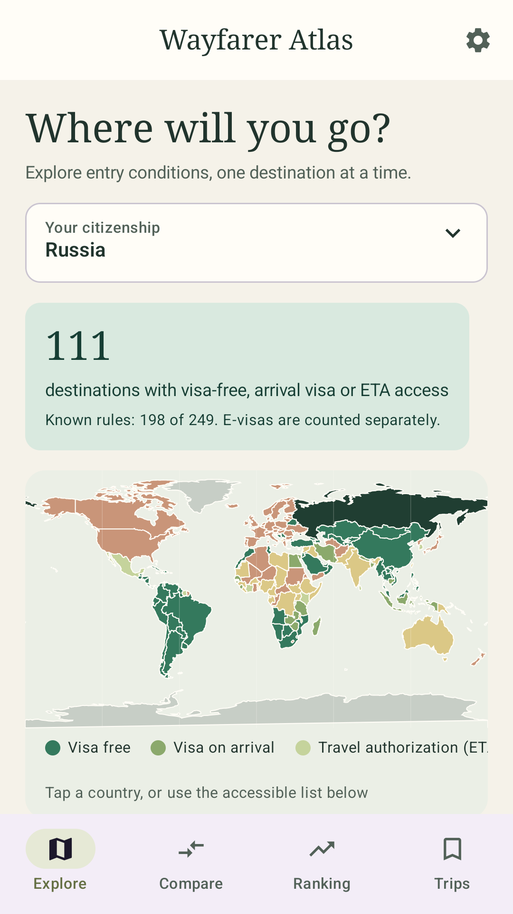
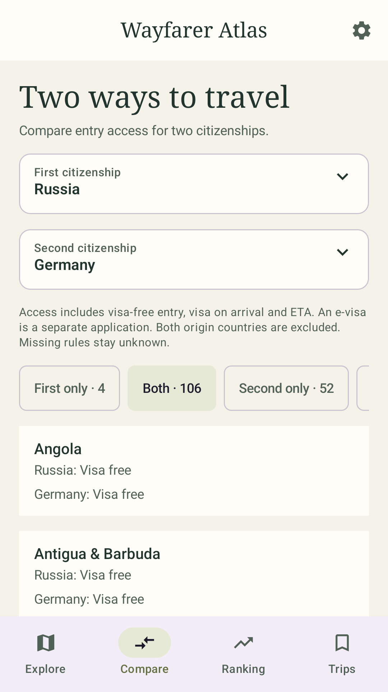
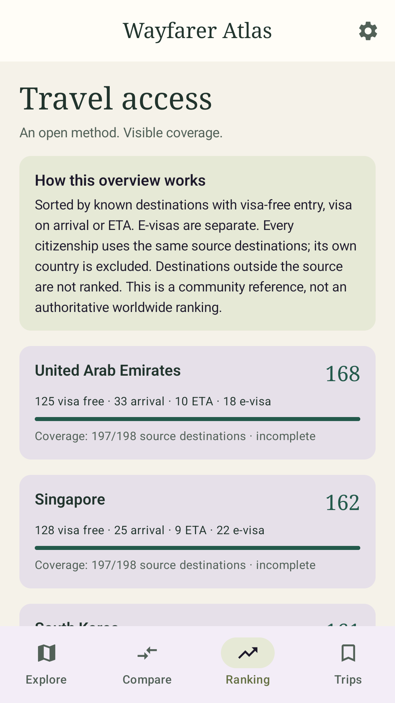
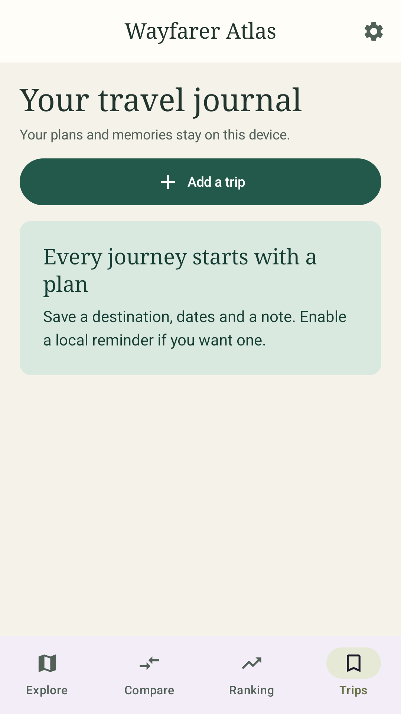

# Wayfarer Atlas — user guide

[Русский](user-guide.ru.md) · [Home](../README.md) · [Download APK](https://github.com/ArtiomNosov/wayfarer-atlas/releases/latest)

Requires Android 8.0 or later. This guide describes **version 0.1.1**. The screenshots show the running app; counts and entry conditions may change after reference updates.

## 1. Install the app

1. Open the [latest GitHub release](https://github.com/ArtiomNosov/wayfarer-atlas/releases/latest) on your phone.
2. Under **Assets**, download the file ending in **`-release.apk`**, such as `wayfarer-atlas-0.1.1-release.apk`. The `.aab` file is for store publishing, and **Source code** archives are for developers.
3. Open the download in your browser or Files app and tap **Install**.
4. If Android asks for permission to install from this source, tap **Settings** in that message and allow the specific browser or file manager you used to open the APK. Return to the installation. You can switch this permission off afterward. Labels vary by phone; see [Android's official instructions](https://support.google.com/pixelphone/answer/7391672?hl=en).
5. Tap **Open**. You do not need an app account.

Some devices apply additional installation restrictions, including developer verification. If you see such a message, read it and [Android's official explanation](https://support.google.com/android/answer/17588095?hl=en); installation availability depends on the device and its policies.

**To update:** download the new `-release.apk` from the same page and install it over the previous release version, **without uninstalling the app**. Journal retention was tested for the 0.1.0 → 0.1.1 update. If Android reports a signature conflict, do not uninstall to force the update: uninstalling removes the journal. Check that you downloaded the release APK from this repository rather than a debug build.

## 2. Read the notice and choose your citizenship

On first launch, read **Before you travel** and tap **Understood**. The notice explains that information may be incomplete, inaccurate or out of date. Before booking, submitting applications or travelling, check the current requirements with the destination's official immigration authority or consulate.

Your acknowledgement is stored on the phone. To read the notice again, tap the gear → **Travel information notice**. It also appears once after an update from an older version that had no acknowledgement.

On **Explore**, tap **Your citizenship**, search by country name or two-letter code and select the country. Choose the citizenship of the passport you intend to travel with. You do not need to enter, photograph or scan a passport.

## 3. Find a destination and check its source

1. Tap a country on the map or scroll down to the destination list. Use the list for small territories: the map does not contain every outline.
2. Enter a name or code in **Search destinations**, for example `HK` for Hong Kong.
3. Choose a filter if needed: **All**, **Accessible**, **E-visa**, **Visa required** or **Unknown**. The filter row and map legend scroll horizontally.
4. Tap a destination. Read its category, stay limit if provided, notes and verification date. Tap a source name to open it in your browser and confirm the current requirements.

**Accessible** includes visa-free entry, visa on arrival and electronic travel authorization (**ETA**). An ETA may require an application before departure; this category does not promise entry without preparation. **E-visas** are counted separately. **No reliable data** means you must check the requirements; it does not mean visa-free entry.

For example, version 0.1.1 lists **Russia → Hong Kong** as a visa-free short visit of up to 14 days with an ordinary passport, with an Immigration Department source link. Check that link and whether its conditions apply to your passport before travelling.

The general reference covers short-stay tourism, ordinary passports and direct entry. It does not calculate transit eligibility, residence-permit alternatives or permitted days within rolling windows.

## 4. Compare two citizenships

1. Open **Compare**.
2. Choose different values for **First citizenship** and **Second citizenship**.
3. Switch between **First only**, **Both**, **Second only** and **Unknown**. Scroll the group row sideways if needed.
4. Each destination shows the category for both citizenships. Tapping a row opens details and sources for the **first** citizenship. For the second, select that citizenship on Explore and open the destination there.

Access uses the same categories: visa-free entry, visa on arrival or ETA. Both origin countries are excluded; missing rules remain unknown.

## 5. Read the ranking alongside coverage

Open **Ranking**. The number on the right counts known destinations with visa-free entry, visa on arrival or ETA. The category breakdown and coverage below show how many source destinations have a known rule.

Every citizenship uses the same source destination set, excluding its own country. Destinations outside that set are not ranked, and e-visas do not increase the main score. Incomplete coverage limits the comparison. This is the app's own overview, rather than an authoritative worldwide passport index.

## 6. Keep a journal and enable reminders

1. Open **Trips** → **Add a trip**.
2. Choose a **Destination**, start and end dates. Use the calendar icons or enter **YYYY-MM-DD**. The end cannot be before the start.
3. Add an optional note and enable **Trip reminder** if wanted.
4. Tap **Save trip**. On Android 13 and later, Android asks for notification permission when you first save with a reminder enabled. If you decline, the trip is saved with its reminder switched off.
5. Tap a saved trip card to edit it. To remove one trip, tap its bin icon and confirm.

A reminder is scheduled for the start day at approximately **09:00 in the device's local time**. Android may delay delivery, so it should not be used as an alarm clock. Past start dates do not schedule a reminder. If notifications are missing, check the app's notification permission in Android settings, then edit the trip, enable its reminder and save again. This reminds you of a trip's start; it does not monitor visa-rule changes.

Journal totals include future plans. Both boundary dates count, and overlapping travel days are counted once.

## 7. Update the reference and change language

Tap the gear at the top right. Choose **English** or **Русский** for the app language. Both languages work offline; the theme follows the device setting.

Connect to the internet and tap **Update reference data** to download available updates. Version 0.1.1 handles its sources as follows:

| Source | What the update button does |
| --- | --- |
| VisaChecker community dataset | Downloads the public JSON from GitHub |
| Hong Kong Immigration Department | Downloads Hong Kong's official CSV |
| Immigration New Zealand | Reviewed bundled snapshot; updated with app releases |
| Macao Public Security Police Force, Russia rule | Reviewed bundled factual summary; updated with app releases |

Each source card shows its links, dates and download result. **Official source state date**, **snapshot checked/imported** and **last downloaded** are different dates. A new download does not itself mean new entry rules. If a source is unavailable or its file is invalid, the last valid data remains available and Settings shows a message. The bundled reference and saved journal work offline after installation; source websites need a browser and internet connection.

Official supplements take priority over the community dataset. Conflicting official records remain unknown and display both source links. See [data sources and limitations](data-sources.md) for details.

## 8. Storage and deletion

Your citizenship preference, language, notice acknowledgement and journal stay on this device. There are no accounts, cloud sync, journal export or Android backup for app data. **Uninstalling the app, clearing its data or moving to another phone will lose the journal.** If you need to keep the records, save the important information separately before doing so.

To remove the whole journal, tap the gear → **Clear travel journal** and confirm. This deletes its entries and reminders and cannot be undone.

The app does not use the camera, store documents or include ads, purchases or analytics SDKs. Manual reference updates connect to `raw.githubusercontent.com` and `www.immd.gov.hk`. These hosts receive standard connection information, including your IP address; the app does not send them your citizenship, trips or notes. Source links open in your browser under the relevant website's policies.

For app questions or bugs, use [GitHub Issues](https://github.com/ArtiomNosov/wayfarer-atlas/issues). Include the app version, phone model and reproduction steps. For a data issue, a citizenship/destination pair and a public official source link are enough; you do not need to attach a passport or personal journal entries.

Store publishing is covered separately in the [Google Play publisher guide, in Russian](release/google-play-guide.ru.md).
