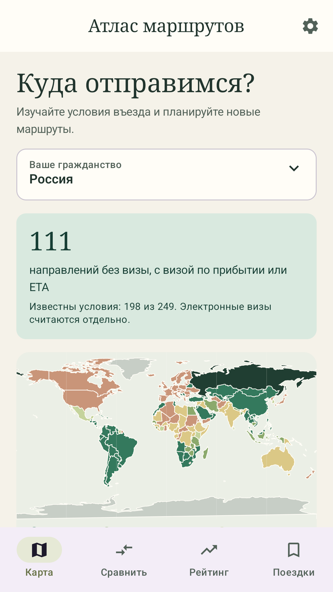
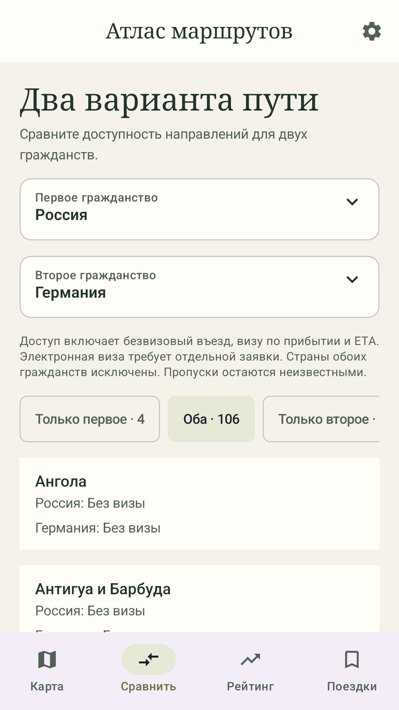
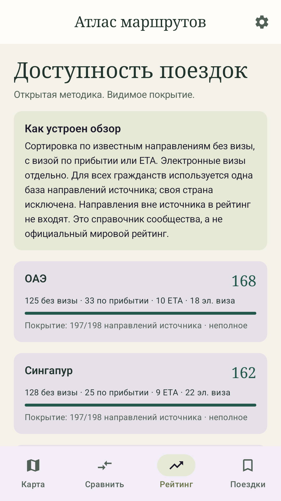
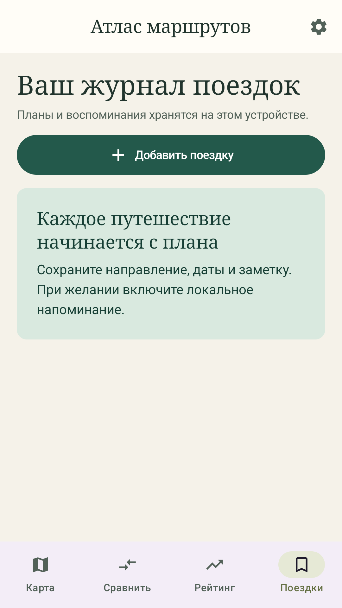

# Атлас маршрутов — инструкция пользователя

[English](user-guide.en.md) · [На главную](../README.md) · [Скачать APK](https://github.com/ArtiomNosov/wayfarer-atlas/releases/latest)

Для Android 8.0 и новее. Инструкция соответствует версии **0.1.1**. Иллюстрации сняты в работающем приложении; числа и условия могут меняться после обновления справочника.

## 1. Установите приложение

1. Откройте на телефоне [страницу последнего выпуска GitHub](https://github.com/ArtiomNosov/wayfarer-atlas/releases/latest).
2. В разделе **Assets** скачайте файл с окончанием **`-release.apk`**, например `wayfarer-atlas-0.1.1-release.apk`. Файл `.aab` предназначен для публикации в магазине, а архив **Source code** — для разработчиков.
3. Откройте загрузку в браузере или приложении «Файлы» и нажмите **Установить**.
4. Если Android предложит разрешить установку из этого источника, откройте **Настройки** в этом сообщении и разрешите её только браузеру или файловому менеджеру, которым открыли APK. Вернитесь к установке. После неё это разрешение можно выключить. Названия пунктов зависят от телефона. Порядок описан в [официальной справке Android](https://support.google.com/pixelphone/answer/7391672?hl=ru).
5. Нажмите **Открыть**. Аккаунт для приложения не нужен.

Некоторые устройства применяют дополнительные ограничения установки, в том числе проверку разработчика. Если появляется такое сообщение, прочитайте его и [официальное объяснение Android](https://support.google.com/android/answer/17588095?hl=ru); доступность установки зависит от устройства и его правил.

**Обновление:** скачайте новый `-release.apk` с той же страницы и установите поверх прежней release-версии, **не удаляя приложение**. Сохранение журнала при обновлении 0.1.0 → 0.1.1 проверено. Если Android сообщает о конфликте подписи, не удаляйте приложение ради установки: при удалении журнал исчезнет. Проверьте, что скачали именно release APK из этого репозитория, а не debug-сборку.

## 2. Начните с гражданства и предупреждения

При первом запуске прочитайте предупреждение **«Перед поездкой»** и нажмите **«Понятно»**. Оно поясняет, что сведения могут быть неполными, неточными или устаревшими. Перед покупкой билетов, подачей документов и поездкой проверяйте требования в официальной миграционной службе или консульстве страны назначения.

Подтверждение сохраняется на телефоне. Повторно открыть текст можно через значок шестерёнки → **«Важная информация о поездках»**. После обновления со старой версии без такого подтверждения предупреждение тоже появится один раз.

На вкладке **«Карта»** нажмите **«Ваше гражданство»**, найдите страну по названию или двухбуквенному коду и выберите её. Это гражданство паспорта, с которым вы планируете поездку. Паспорт вводить, фотографировать или сканировать не требуется.

## 3. Найдите направление и проверьте источник

1. Нажмите страну на карте или прокрутите ниже к списку. Небольшие территории удобнее искать в списке: на карте есть не все контуры.
2. В поле **«Поиск направлений»** введите название или код, например `HK` для Гонконга.
3. При необходимости выберите фильтр: **«Все»**, **«Доступны»**, **«Электронная виза»**, **«Нужна виза»** или **«Неизвестно»**. Ряд фильтров и легенда карты прокручиваются вбок.
4. Нажмите направление. Прочитайте категорию, срок, если он указан, примечания и дату проверки. Нажмите название источника, чтобы открыть его в браузере и уточнить действующие условия.

**«Доступны»** включает безвизовый въезд, визу по прибытии и электронное разрешение **ETA**. ETA может требовать предварительной заявки; это не обещание въезда без подготовки. **Электронная виза** учитывается отдельно. **«Нет надёжных данных»** означает, что условия нужно уточнить, и не означает безвизовый въезд.

Например, в версии 0.1.1 для **Россия → Гонконг** указан безвизовый краткий визит до 14 дней по обычному загранпаспорту со ссылкой на Immigration Department. Перед поездкой всё равно проверьте условия по ссылке и применимость к своему паспорту.

Общий охват справочника — краткосрочный туризм, обычный загранпаспорт и прямой въезд. Не используйте его как расчёт транзита, права въезда по ВНЖ или разрешённых дней в скользящем периоде.

## 4. Сравните два гражданства

1. Откройте **«Сравнить»**.
2. Выберите разные значения **«Первое гражданство»** и **«Второе гражданство»**.
3. Переключайте группы **«Только первое»**, **«Оба»**, **«Только второе»**, **«Неизвестно»**. При необходимости прокрутите ряд вбок.
4. В каждой строке сравните категории для двух гражданств. Нажатие строки открывает сведения и источник для **первого** гражданства; для второго откройте направление на вкладке «Карта», выбрав второе гражданство.

Сравнение использует тот же состав «доступа»: без визы, виза по прибытии или ETA. Страны обоих выбранных гражданств исключены, пропуски остаются неизвестными.

## 5. Читайте рейтинг с учётом покрытия

Откройте **«Рейтинг»**. Число справа — количество известных направлений без визы, с визой по прибытии или ETA. Ниже показаны отдельные категории и покрытие: сколько направлений источника имеют известное правило.

Для всех гражданств берётся одна база направлений источника; собственная страна исключается. Направления вне базы в рейтинг не входят, электронные визы не прибавляются к основному числу. При неполном покрытии сравнение ограничено имеющимися данными. Это собственный обзор приложения, а не официальный мировой индекс паспортов.

## 6. Ведите журнал и включайте напоминания

1. Откройте **«Поездки»** → **«Добавить поездку»**.
2. Выберите **«Направление»**, начало и конец. Даты можно выбрать значком календаря или ввести в формате **ГГГГ-ММ-ДД**; конец не может быть раньше начала.
3. При желании добавьте заметку и включите **«Напоминание о поездке»**.
4. Нажмите **«Сохранить»**. На Android 13 и новее при первом сохранении с напоминанием система запросит доступ к уведомлениям. Если отказать, поездка сохранится с выключенным напоминанием.
5. Чтобы изменить запись, нажмите её карточку. Чтобы удалить одну поездку, нажмите корзину и подтвердите действие.

Напоминание планируется на день начала примерно на **09:00 по местному времени устройства**. Android может задержать его, поэтому не полагайтесь на него как на будильник. Для прошедшей даты напоминание не планируется. Если уведомлений нет, проверьте разрешение в настройках Android для приложения; затем откройте поездку, включите напоминание и сохраните её заново. Это напоминание о начале поездки, а не уведомление об изменении визовых правил.

Сводка журнала включает и будущие планы. Дни начала и конца учитываются, совпадающие дни нескольких поездок считаются один раз.

## 7. Обновляйте справочник и переключайте язык

Нажмите шестерёнку справа вверху. Для русского или английского выберите **«Русский»** или **English**. Оба языка доступны без интернета; тема следует настройке устройства.

Для получения данных подключитесь к интернету и нажмите **«Обновить справочник»**. В версии 0.1.1 источники обновляются так:

| Источник | Что делает кнопка обновления |
| --- | --- |
| Общий набор VisaChecker | Загружает открытый JSON из GitHub |
| Hong Kong Immigration Department | Загружает официальный CSV Гонконга |
| Immigration New Zealand | Встроенный проверенный срез; обновляется с выпуском приложения |
| Macao Public Security Police Force, правило для России | Встроенная проверенная сводка; обновляется с выпуском приложения |

Карточки источников показывают ссылки, даты и результат загрузки. **Дата состояния данных**, **сверка/получение среза** и **последняя загрузка** — разные даты. Новая загрузка сама по себе не означает новые правила. Если источник недоступен или файл некорректен, остаются последние корректные данные, а в настройках появляется сообщение. После установки встроенный справочник и сохранённый журнал работают без интернета; ссылки на источники требуют браузера и сети.

Официальные дополнения имеют приоритет перед общим набором. Если официальные записи противоречат друг другу, приложение оставляет условия неизвестными и показывает обе ссылки. Подробнее: [источники и ограничения данных](data-sources.md).

## 8. Хранение и удаление данных

Гражданство, язык, подтверждение предупреждения и журнал хранятся на этом устройстве. Аккаунтов, облачной синхронизации, экспорта журнала и резервного копирования Android для данных приложения нет. **Удаление приложения, очистка его данных или смена телефона приведут к потере журнала.** Если записи важны, сохраните нужные сведения отдельно до таких действий.

Чтобы удалить весь журнал, откройте шестерёнку → **«Очистить журнал поездок»** и подтвердите. Удалятся записи и их напоминания; отменить это нельзя.

Приложение не использует камеру, не хранит документы, не содержит рекламы, покупок и SDK аналитики. При ручном обновлении оно обращается к `raw.githubusercontent.com` и `www.immd.gov.hk`: хостинги получают обычные сведения о соединении, включая IP-адрес, но приложение не отправляет им гражданство, журнал или заметки. Ссылки на первоисточники открываются вашим браузером, где действуют правила соответствующего сайта.

Вопрос или ошибка приложения: [GitHub Issues](https://github.com/ArtiomNosov/wayfarer-atlas/issues). Укажите версию, модель телефона и шаги воспроизведения. Для ошибки справочника достаточно пары «гражданство → направление» и публичной официальной ссылки; паспорт и личные записи прикладывать не нужно.

Для владельца, который готовит публикацию в магазине, есть отдельное [руководство Google Play](release/google-play-guide.ru.md).
